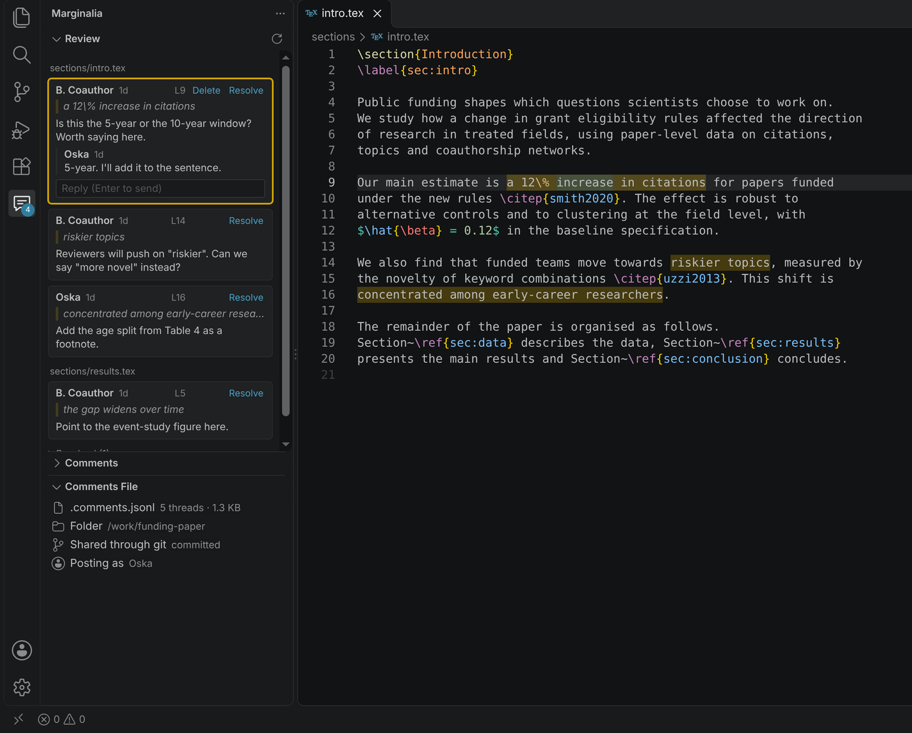
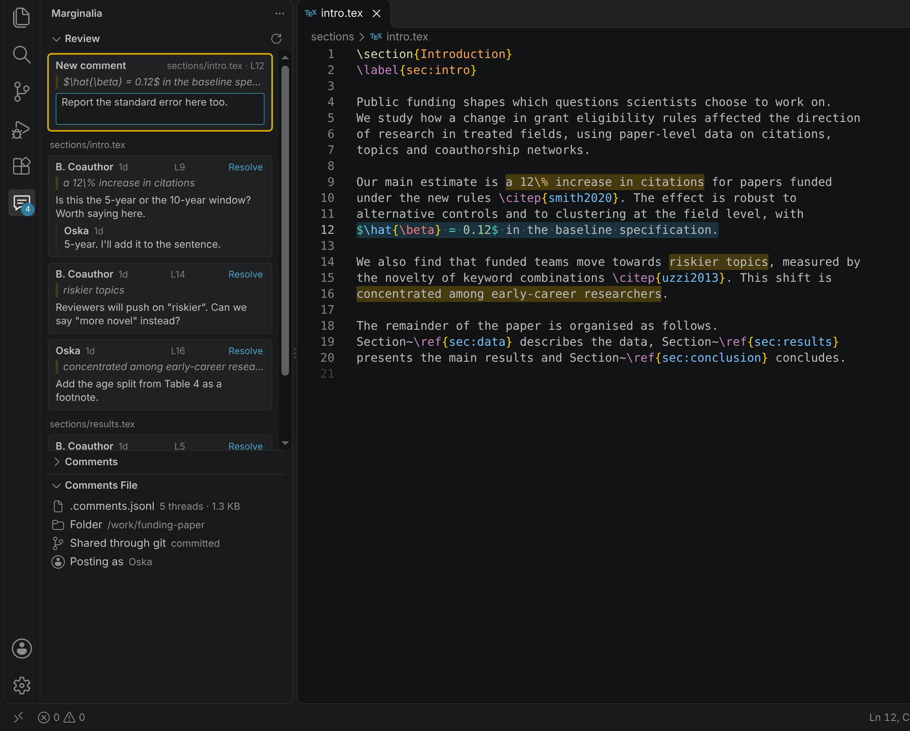
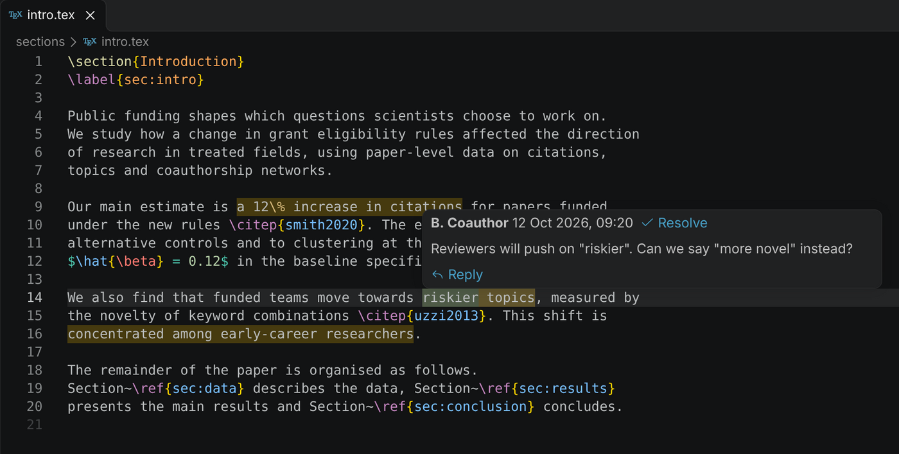

# Marginalia

Overleaf-style comments for LaTeX in VS Code. Select text in a `.tex` file, leave a comment, and it appears as a card in the margin, with replies and Resolve, just like on Overleaf. Comments live in one plain text file in your project, so they are committed and shared through git with your co-authors, and can be read or written by an LLM.

Your papers stay in your own editor and repository; nothing is uploaded anywhere. It works the same in Markdown, code or any other text file you turn it on for, see [Other file types](#other-file-types).

## Getting started

1. Install Marginalia from the Extensions view and open your paper's folder.
2. Select some text in a `.tex` file, right-click and choose "Add comment on selection", or press Ctrl+K then Ctrl+M (Cmd+K then Cmd+M on a Mac). With nothing selected it uses the whole line. A card opens at the top of the sidebar: type your comment and press Enter to post it, or Esc to cancel.
3. Commented text is highlighted. Hover over it to see the comment in a popup. Resolve in the popup resolves it, and Reply opens the sidebar with your cursor in that comment's reply box.

## The sidebar

Click the Marginalia icon in the left activity bar. The Review section shows every comment as a compact card, grouped by file in the order they appear in the text. Open comments come first and resolved ones are tucked into a "Resolved" group. Click a card to jump to its text. The card for the comment your cursor is in is outlined in yellow and shows a reply box: type, press Enter to send (Shift+Enter for a new line), or press Resolve. Hover a card to get a Delete link; it asks before deleting. The number on the icon is how many comments are open.

The plain "Comments" list underneath is the same information as a tree, collapsed by default.

At the bottom, a "Comments file" section shows where your comments are kept. Click the `.comments.jsonl` row to open the file, or the Folder row to show it in Finder or Explorer. A row tells you whether the file stays on your computer or is shared through git, and another shows the name your comments are posted under. Click that one to change it.

To keep the cards beside your text, drag the Marginalia icon from the left activity bar to the right edge of the window. The yellow ticks on the scrollbar show where the open comments are. The cards use the same colours for the quote bar and the outline of the active card. Both colours can be changed under `workbench.colorCustomizations` as `marginalia.highlightBackground` and `marginalia.overviewRuler`.

If something does not work, open View > Output and choose "Marginalia" from the dropdown. Errors are printed there.

## Other file types

Comments start out on for `.tex` files only. To comment on another kind of file, such as Markdown notes, BibTeX or code, right-click in one and choose "Enable comments for this file type". That adds a pattern such as `**/*.md` to the `marginalia.files` setting in this folder's `.vscode/settings.json`. Edit that list of globs, relative to the comments root, to pick files more precisely, for example `"notes/**/*.md"`. Comments on files that no longer match stay in the sidebar but are not highlighted.

The extension starts by itself in a folder that has a `.tex` file or a `.comments.jsonl`. Elsewhere, click its icon in the activity bar or run one of its commands.

## Where comments are stored

One file, `.comments.jsonl`, in the project root. The root is the top of the git repository the folder you opened is in, or the folder you opened if there is no git repo. To choose it yourself, set `marginalia.root` in settings; the change applies straight away. In a multi-root workspace only the first folder is used.

In a folder you have not marked as trusted, the extension does not run git: the root is the folder you opened (or the setting), your name comes from `marginalia.author` or your login name, and the "Comments file" view cannot tell whether the file is shared.

Comments are matched to text by quoting it, not by line number, so they survive editing elsewhere, reflowing paragraphs and one-sentence-per-line tools. If the commented text itself is edited, the comment follows the words around it and its card says "Text changed since this comment". If the text is deleted, the card says "Text not found in the file" and keeps the original quote.

## Sharing with co-authors

Commit `.comments.jsonl`. To make two people adding comments at the same time merge cleanly, add this line to `.gitattributes`:

    .comments.jsonl merge=union

To keep comments to yourself, add `.comments.jsonl` to `.gitignore` instead.

## File format

One JSON object per line, applied from top to bottom. Comments are shown by file and then by where they sit in the text, whatever order the lines are in. Only the first kind of line is needed to start a thread, so people and LLMs can write them by hand.

    {"t":"thread","id":"a1b2c3d4","file":"sections/intro.tex","exact":"the commented text","prefix":"words just before","suffix":"words just after","offset":1234,"author":"Name","ts":"2026-10-13T10:00:00Z","text":"The comment"}
    {"t":"reply","id":"a1b2c3d4","author":"Name","ts":"2026-10-13T10:05:00Z","text":"A reply"}
    {"t":"status","id":"a1b2c3d4","resolved":true}
    {"t":"anchor","id":"a1b2c3d4","exact":"the edited text","prefix":"words just before","suffix":"words just after","offset":1240}
    {"t":"delete","id":"a1b2c3d4"}

- Required for a new thread: `file` (relative to the root, inside it) and `exact` (the text to attach to). `text` is the comment; a thread without it starts with no message.
- `id` may only use letters, digits, `_` and `-`. If it is left out, the thread gets an id made from its contents, which stays the same when lines are added elsewhere in the file.
- An `anchor` line is written when you save a file whose commented text was edited, so the comment follows the new wording.
- `prefix` and `suffix` are optional but help when the same words appear more than once. `offset` (optional) is the character position where the text started, used to choose between copies with the same surroundings.
- `resolved` must be `true` or `false`; any other value is ignored.
- Lines that are not valid JSON, including git conflict markers, are ignored, and so are threads whose `file` is absolute or points outside the root.

## Development

Open this folder in VS Code and press F5 (Run > Start Debugging) to try your changes in a second window. To install your build in your normal VS Code:

    npm run package
    code --install-extension marginalia-0.0.1.vsix

Run the tests with:

    npm test

`test/extension.test.js` runs the extension against a stand-in for VS Code, so it checks the wiring but not how the real editor draws things.

## License

MIT
